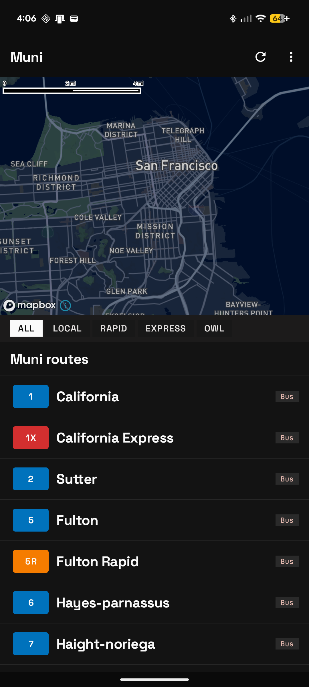
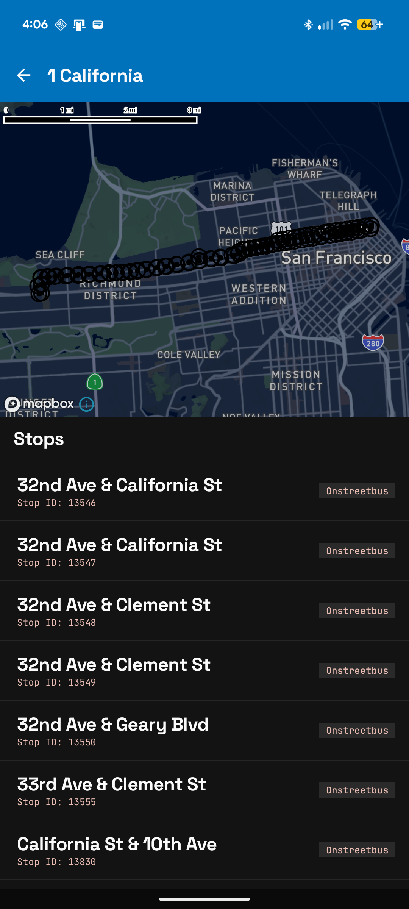
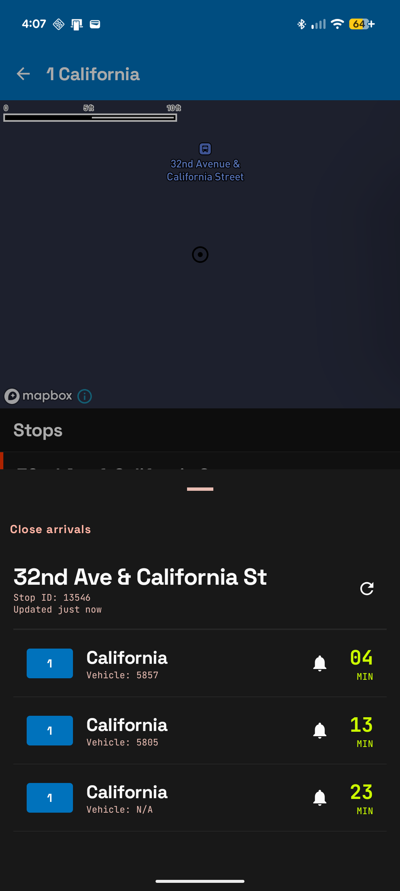

# GoMuni

GoMuni helps San Francisco riders find a Muni bus route, choose a stop, and see when the next bus is coming. Explore stops on an interactive map, check live arrival estimates, and follow an incoming bus with a tracking notification.

## Screenshots

| Explore routes | Find your stop | Check live arrivals |
| --- | --- | --- |
|  |  |  |
| Browse routes and narrow the list by service type. | Select a route to explore its stops on the map and in a list. | Open a stop for arrival estimates; tap a bell to start tracking. |

Captured from the current debug build on a Pixel 6 running Android 16. Arrival times and vehicle availability reflect live data at capture time.

## Features

- **Route discovery:** browse Muni bus routes, filter by Local, Rapid, Express, or Owl service, and sort by route ID or name.
- **Favorite routes:** save lines locally and show matching favorites first, with the same filtering and sorting.
- **Map and stop browsing:** view a route's stops on a Mapbox map and in a list with stop names and IDs; see incoming vehicles when data is available.
- **Live arrivals:** check upcoming buses, minute estimates, vehicle IDs when provided, and the last update time. Refresh arrivals on demand.
- **Bus tracking:** tap an arrival's bell to follow it through an ongoing Android notification, with actions to refresh its ETA or stop tracking. Tap the notification to return to the stop. Notification permission is required.

## Tech Stack
- **Kotlin** — Application language
- **Jetpack Compose** — UI
- **Hilt** — Dependency injection
- **Retrofit** — Network/API communication
- **Room** — Local data persistence
- **Mapbox** — Maps and map visualization

## Requirements
- Android Studio
- Android SDK 36
- Minimum Android version: **Android 8.0 (API 26)**
- A 511 SF Bay API key ([https://511.org/open-data/token](https://511.org/open-data/token))
- A Mapbox access token ([https://www.mapbox.com/mobile-maps-sdk](https://www.mapbox.com/mobile-maps-sdk))

## Configuration
GoMuni requires API credentials that should **not** be committed to the repository.

Add the following values to your local **local.properties** file:
```
transit_api_key=<511 api key here>
MAPBOX_DOWNLOADS_TOKEN=<Mapbox access token here>
```
Replace the placeholder values with your own credentials.

Make sure local.properties remains uncommitted and is included in your **.gitignore**.

## Building
1. Clone the repository:
```
git clone https://github.com/matt-nguyen/GoMuni.git
cd GoMuni
```
2. Add your API credentials to **local.properties** as described above.

3. Open the project in Android Studio.

4. Sync the Gradle project.

5. Build and run the app on an Android device or emulator running Android 8.0 (API 26) or newer.

## Data
GoMuni uses the [**511 SF Bay API**](https://511.org/open-data/transit) to retrieve transit information, including Muni routes, stops, and arrival estimates.
